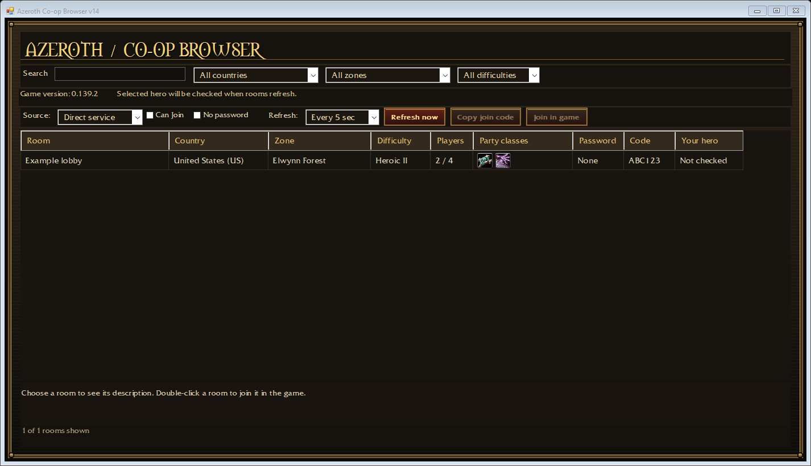

# Azeroth Survivors Co-op Browser

An unofficial Windows companion browser for Azeroth Survivors, with a dark-and-gold fantasy panel theme, a larger lobby list, filters, and class badges.

**Built with AI in mind:** this project was developed collaboratively with OpenAI Codex. AI assisted with implementation, protocol investigation, documentation, and testing. The source, build scripts, and maintenance notes are included so humans and AI coding assistants can inspect and improve it. AI assistance does not guarantee correctness; see the compatibility and testing limits below.



## Features

- Browse public lobbies directly, without opening Co-op in the game.
- Filter by country, zone, difficulty, text, and password.
- Optional **Can Join** filter based on the hero selected in the running game.
- Original Warcraft class icons and roster details.
- Dark-and-gold table and dropdown scrollbars matching the panel theme.
- Friz Quadrata UI and Morpheus heading fonts in the packaged release; serif fallback when optional fonts are unavailable.
- Refresh every **5 seconds by default**, with Manual, 1-second, 3-second, and 10-second options.
- Double-click a room, or use **Join in game**, to join through the running game.
- Keep **Copy join code** as a manual fallback.
- Optional **Game view** source for the game's own lobby data.

Double-click joining passes the code directly to the running game; no code entry is needed. Password-protected rooms prompt for a password in the browser. The game still enforces its normal version, zone, capacity and password rules. This tool does not enable cross-version multiplayer.

## Download and run

Download the executable from [Releases](https://github.com/supercalfrag/azeroth-survivors-coop-browser/releases). Windows x64 and .NET Framework 4.7.2 or later are recommended. No installer or administrator access is normally required; the executable is unsigned.

1. Open `AzerothCoopBrowser.exe`.
2. Leave **Source** set to **Direct service**.
3. The game version appears as text to the left of the selected hero. It detects a running game, or a game executable beside the browser, and rechecks when the running game changes. With no game available it starts from the packaged fallback version; the last detected version is retained when you close the game.
4. Refresh and set your filters.
5. Double-click a room to join. For a protected room, enter its password in the browser prompt. The game is brought forward after the request is submitted.

Use the game’s main menu for joining. The browser reports **Join request sent**, which means submission succeeded, not that the server admitted you. Check the game for rejection, full-room, or connection errors. No automatic retry is made. Copy join code remains available for unsupported builds.

Direct browsing works with the game closed. Hero eligibility requires the game running. **Can Join** hides rooms whose eligibility is unknown; uncheck it to see the returned list when hero reading is unavailable.

The one-second option polls for a list; it is not a guarantee of one-second freshness or server-pushed updates. Requests do not overlap.

## Compatibility and limitations

This release is companion browser v14. Native double-click joining is verified only for **0.139.2**, SHA-256 `0BB6C557C5F6CFEEA212761A33554F9A5647CE7CB7E03B8A163B95489496E908`. Other builds reject native joining while lobby browsing remains available. The selected-hero reader has no executable version/hash gate. It locates resource owners using allocation metadata, executable-section pointers, valid hero identity/zone text, bounded progression vectors, repeated stable snapshots, and one unique hero/profile pair. Cached owners are revalidated; invalid owners trigger a fresh scan. Missing, changed, unsupported or ambiguous data leaves eligibility unchecked rather than guessed. Automatic detection was live-verified on 0.139.2 with Warlock and four normal zones. The earlier version-gated reader was verified on 0.139.0. Direct browsing can continue with the detected game version, provided the service protocol remains compatible. No claim of current or universal game-version support is made.

Normal-zone eligibility uses the selected class's unlocked zone count. Heroic eligibility requires that class's Normal clear plus the account's completed Heroic tiers, capped at V. Unsupported zones or data are marked unchecked.

The service has returned up to 100 rooms in testing; this is not a guarantee that all hosted games are listed. Listings may change before you join. A copied code does not reserve a slot. Initial hero scanning can take 15–30 seconds.

## Process access and privacy

- **Direct service** connects to `wss://wow.aethus.pl/coop/lobby/`, sending a protocol/version greeting and list requests. It only requests lists; it does not itself host or join rooms, send chat, or upload hero progression.
- Optional selected-hero access queries and reads game memory only; it does not install a hook or modify saves.
- **Game view** is different: it installs a temporary, compatibility-checked renderer capture hook in game memory. The in-game lobby list must be open. Close the browser normally to restore the hook; avoid running multiple capture readers together.
- **Join in game / double-click** briefly installs a separate verified game-thread bridge, constructs the normal native Join command, submits it to the game’s mutex-protected command queue, and removes the bridge. No separate joining connection or remote thread is created. The code is passed automatically; entered passwords are submitted to the normal game flow, not the direct-list connection. Temporary request storage is cleared during cleanup.
- No trainer, save editor, personal saves, captured player lists, or credentials are included in this repository.

The game's service and protocol are operated by its developer and may change independently of this project. There is no official affiliation or endorsement.

## Build from source

On Windows with .NET Framework's C# compiler:

```powershell
powershell -NoProfile -ExecutionPolicy Bypass -File .\build.ps1
powershell -NoProfile -ExecutionPolicy Bypass -File .\test.ps1
```

The output is `dist\AzerothCoopBrowser.exe`. No NuGet dependencies or game files are required. The class atlas in `assets/ClassAtlas.png` is embedded by default. `-ClassAtlas` can select a different compatible local PNG.

To build with locally supplied WoW fonts:

```powershell
./build.ps1 -FontDirectory "C:\path\to\fonts"
```

The folder should contain `FRIZQT__.TTF` and `MORPHEUS.TTF`. Release executables embed these fonts privately, without installing system fonts. The font files are not committed to this repository. Source builds without them use system-serif fallbacks, or can load them from a `Fonts` folder beside the executable.

## Validation

The original v7 was live-tested for direct listings with Co-op closed, hero selection changes, eligibility filtering, and refresh settings. That historical testing applies to the inspected build, not every newer update. Public-package checks cover compilation, protocol decoding with synthetic data, malformed responses, eligibility boundaries, and offline UI rendering. They do not join public rooms or prove compatibility with a newer game. Additional v8 checks execute the native bridge in an isolated own-process fixture, covering dry runs, exactly-once submission, code/password transfer, allocation failure, and cleanup. A live game dry run constructed and discarded the Join command without sending it, then restored the full native poll function exactly. A player confirmed that double-click joining works, the party panel opens immediately, and the selected-hero line is correct in v9. The original class atlas was restored and confirmed in the local build; v13 includes it in public downloads too. Friz Quadrata and Morpheus family names were checked after loading, and the font layout was visually inspected.

See [AI development notes](AI_DEVELOPMENT.md), [protocol notes](PROTOCOL.md), and [contributing](CONTRIBUTING.md).

## License and credits

Project-authored code is available under the [MIT License](LICENSE). Azeroth Survivors and Warcraft names and other third-party properties belong to their respective owners. This repository includes a class-icon atlas as third-party artwork; it does not include game executables, archives, or saves. The panel theme is drawn in code. See [third-party credits](THIRD_PARTY_NOTICES.md) for artwork/font attribution; the MIT license covers project-authored code, not third-party assets.
